<p align="center"></p>
<p align="center">
<a href="https://github.com/DEAL-US/Silence/actions/workflows/ci_test.yml"></a> 
<a href="https://pypi.org/project/Silence/"></a>
<a href="https://pepy.tech/project/silence"></a>&nbsp;</p>

<hr>

> **Silence 3 (in development, proof of concept).** No configuration files to edit: everything is
> set up in the admin panel.
>
> ```
> pip install -e .            # from this repo, in a virtual environment
> silence new myproject       # frontend template ez-ui (default; --template, --url) + admin panel (--no-admin)
> cd myproject
> silence run                 # opens the admin panel at http://127.0.0.1:8080/admin/
> silence createapi           # or from the panel: endpoints/auto_<table>.json
> silence createtests [--http]
> silence test                # runs tests/*.json, each one in a rolled back transaction
> silence hash <password>     # argon2 hash
> silence admin update        # installs or updates the admin panel (admin/)
> ```
>
> Silence is the backend: the student's API (`/api`) and an admin API (`/_silence/v1`,
> [docs/admin-api.md](docs/admin-api.md)). The admin panel (repo `silence-admin-panel`) and
> the frontend templates (`silence-template-v3-*`) are separate repos that `silence new`
> composes. The plan and the decisions are in [docs/plan.md](docs/plan.md) (in Spanish);
> the CI runs `python tests/run_ci.py`.
> The rest of this README describes Silence 2.


Silence is a framework that allows for a rapid deployment of a RESTful API and a Web application around a relational database. Silence revolves around the concept of projects, which contain everything needed to deploy the previously mentioned elements and can be moved and/or shared between computers or systems with ease.

Check out [**Silence's wiki page**](https://github.com/DEAL-US/Silence/wiki) to see how to get started and for detailed documentation.

Silence has been built by the [**DEAL research group**](https://deal.us.es/) as an educational and teaching tool for its use in several courses of the Degree in Computer Science at the University of Seville.



# Documentation and changelog
Please see [**Silence's wiki**](https://github.com/DEAL-US/Silence/wiki) and [**CHANGELOG.md**](CHANGELOG.md)

# Citing Silence
If you find Silence useful for your ongoing research work, please consider citing it as:

```bibtex
@article{borrego2022silence,
    author = {Borrego, Agust{\'i}n and Bermudo, Miguel and Sola, Fernando and Ayala, Daniel and Hern{\'a}ndez, Inma and Ruiz, David},
    title = {{Silence — A web framework for an agile generation of RESTful APIs}},
    journal = {SoftwareX},
    volume = {20},
    pages = {101260},
    year = {2022},
    doi = {10.1016/j.softx.2022.101260},
    url = {https://www.sciencedirect.com/science/article/pii/S2352711022001789}
}
```

# Contributions
All contributions are welcome provided that they follow our [Code of Conduct](CODE_OF_CONDUCT.md).

We keep a [TO-DO](TO-DO.md) with ideas to implement in the future. Feel free to open an issue or send us an email if you need clarifications with any of its items.
