<p align="center"></p>
<p align="center">
<a href="https://github.com/DEAL-US/Silence/actions/workflows/ci_test.yml"></a>
<a href="https://github.com/DEAL-US/Silence/releases"></a>
<a href="https://pepy.tech/project/silence"></a>&nbsp;</p>

<hr>

Silence is an educational framework to build a RESTful API and a web application around a
relational database (MariaDB or MySQL), with little code: the API is generated from the database
and changed in JSON files, and an admin panel helps with everything else. It has been built by the
[**DEAL research group**](https://deal.us.es/) as a teaching tool for several courses of the Degree
in Computer Science at the University of Seville.

```bash
pip install https://github.com/DEAL-US/Silence/archive/refs/tags/v3.0.0.zip   # see Installation in the wiki
silence new myproject       # the project, with its web app template and the admin panel
cd myproject
silence run                 # the API at /api, the web app at / and the admin panel at /admin/
```

Then, in the admin panel: connect the database, load it with the scripts of `sql/`, link the users
table, generate the endpoints, give each one its access (public, logged in, roles or the owner of
each row) and run their tests.



## Silence 3

- **A project is a folder**: `silence.json`, the database scripts (`sql/`), the endpoints
  (`endpoints/*.json`), the tests (`tests/*.json`) and the web app (`web/`).
- **Endpoints**: generated from the database (`auto_<table>.json`) and customized in your own
  files, which replace them; one SQL statement each, with clear status codes (201, 404, 400 with
  the reason, 401, 403…).
- **Access control** in four levels: public, logged in, roles, or the owner of each row (also when
  reading), with roles that act on any row.
- **Users** are the rows of a table of your database: login and logout, sessions with tokens,
  passwords encrypted with argon2 or as plain text (for practice databases).
- **Tests** generated from the endpoints and the data, plus your own, run from the panel.
- **A JS API** for the web app, generated from the molds of the project's template.
- **The admin panel** ([silence-v3-admin-panel-uikit](https://github.com/DEAL-US/silence-v3-admin-panel-uikit))
  and the **templates** ([ez-ui](https://github.com/DEAL-US/silence-template-v3-ez-ui),
  [blank](https://github.com/DEAL-US/silence-template-v3-blank)) are separate repositories:
  Silence is the backend, with an admin API that any client can use
  ([docs/admin-api.md](docs/admin-api.md)).

Silence 3 is not compatible with Silence 2 projects: see
[Migrating from Silence 2](https://github.com/DEAL-US/Silence/wiki/Migrating-from-Silence-2). To
keep using Silence 2: `pip install "silence<3"`.

## Documentation and changelog

Please see [**Silence's wiki**](https://github.com/DEAL-US/Silence/wiki) and
[**CHANGELOG.md**](CHANGELOG.md).

## Development

```bash
pip install -e .                 # from this repo, in a virtual environment
python tests/run_ci.py           # the CI: the API, the admin API and the unit tests (MariaDB)
```

The CI reads the database from the `SILENCE_DB_*` environment variables (by default, the local one
of `tests/ci_project/silence.json`).

## Citing Silence

If you find Silence useful for your ongoing research work, please consider citing it as:

```bibtex
@article{borrego2022silence,
    author = {Borrego, Agust{\'i}n and Bermudo, Miguel and Sola, Fernando and Ayala, Daniel and Hern{\'a}ndez, Inma and Ruiz, David},
    title = {{Silence — A web framework for an agile generation of RESTful APIs}},
    journal = {SoftwareX},
    volume = {20},
    pages = {101260},
    year = {2022},
    doi = {10.1016/j.softx.2022.101260},
    url = {https://www.sciencedirect.com/science/article/pii/S2352711022001789}
}
```

## Contributions

Contributions are welcome: open an issue or a pull request.
